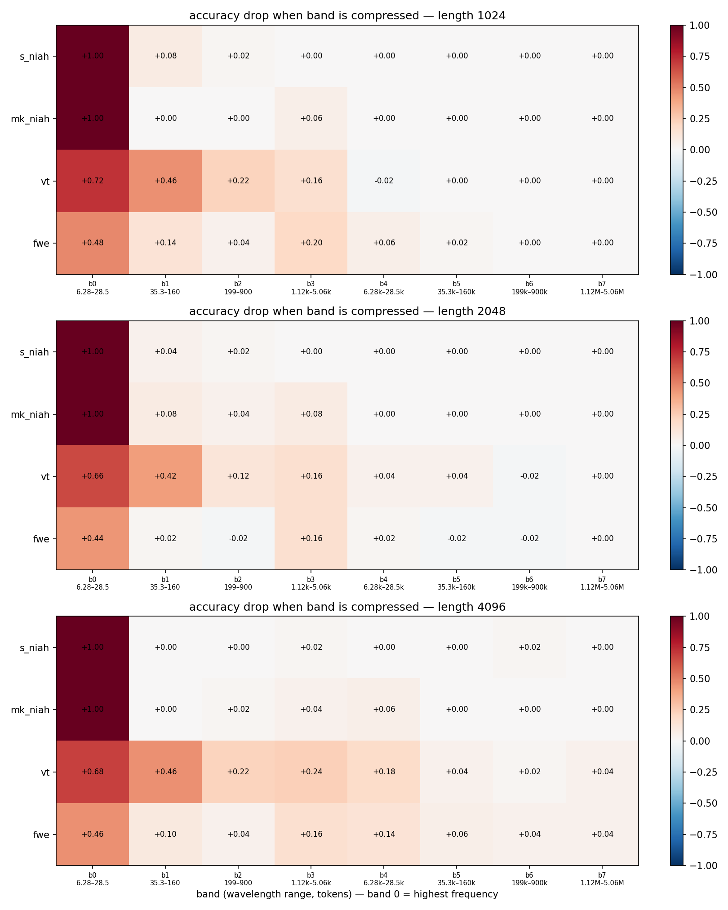
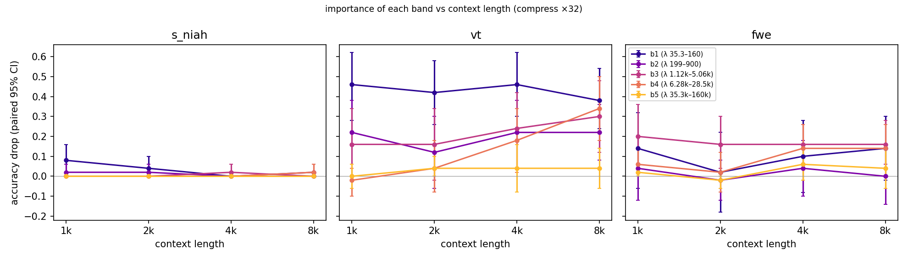
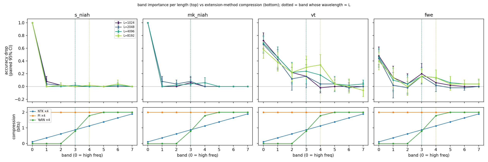

# Ablation dải tần số RoPE: mỗi task long-context phụ thuộc vào tần số nào?

IT4772 (NLP) — Topic 12: *Long-Context LLMs — do LLMs really understand very long context?*

Model: `Qwen/Qwen2.5-1.5B-Instruct` (revision `989aa79`). Toàn bộ số liệu trong báo cáo này đọc từ `results/Qwen__Qwen2.5-1.5B-Instruct/`; cách tái lập ở §8.

---

## Tóm tắt

Chúng tôi đo mức độ mỗi task long-context phụ thuộc vào từng dải tần số của RoPE bằng cách **nén tần số của đúng một dải** ($\theta_i \to \theta_i/32$) trên model đã train, rồi đo accuracy tụt bao nhiêu so với model gốc. Thí nghiệm dùng 4 task kiểu RULER và 5 độ dài context từ 1k đến 16k, tất cả nằm trong context gốc 32k của model.

1. **Retrieval kiểu NIAH chỉ phụ thuộc dải tần số cao nhất.** Ngoài dải 0, không dải nào làm accuracy của s_niah tụt quá 0.08, ở bất kỳ độ dài nào.
2. **Variable tracking (vt) phụ thuộc rộng hơn**: dải 1–4, tức bước sóng từ 35 token đến 28k token.
3. **Dải quan trọng dịch dần về phía tần số thấp khi context dài ra.** Với vt, mức tụt khi nén dải 4 (bước sóng 6.3k–28k) tăng từ −0.02 ở 1k lên +0.18 ở 4k, +0.34 ở 8k và giữ +0.30 ở 16k. Dải 5 (bước sóng ≥ 35k) vẫn không ảnh hưởng ở 16k. Cách đọc phù hợp nhất là: *một dải bắt đầu quan trọng khi bước sóng của nó xấp xỉ độ dài context*.
4. **Liên hệ với các phương pháp mở rộng context.** Ở độ dài ≤ 16k, tương quan giữa importance theo dải và mức nén của NTK/YaRN là **âm**, vì các phương pháp này nén mạnh nhất ở những dải mà chưa task nào dùng tới. Tuy vậy, kết quả 3 dự báo rằng khi context được kéo vượt 32k, vt sẽ cần đúng các dải có bước sóng cỡ 100k, tức vùng YaRN/NTK nén mạnh nhất. Đây là một **cơ chế có thể giải thích** vì sao trong RULER NIAH vẫn gần hoàn hảo còn tracing/aggregation sụp. Chúng tôi suy ra điều này chứ **chưa đo trực tiếp** ở độ dài vượt context gốc.

Theo ba kịch bản ở §5 của spec, kết quả **ủng hộ giả thuyết một phần**. Có khác biệt rõ giữa task dễ và task khó, và task khó dùng các dải tần thấp hơn. Nhưng ở độ dài trong phạm vi đã train, các dải đó chưa phải là vùng bị nén mạnh nhất.

---

## 1. Bối cảnh và câu hỏi

RoPE xoay vector query/key ở vị trí $m$ một góc $m\theta_i$, với $\theta_i = b^{-2i/d}$, $i = 0,\dots,d/2-1$. Chỉ số $i$ nhỏ là tần số cao, bước sóng $\lambda_i = 2\pi/\theta_i$ ngắn, mang thông tin cục bộ. $i$ lớn là tần số thấp, bước sóng dài, mang thông tin toàn cục.

Các phương pháp mở rộng context đều **nén một phần các tần số này**, và chỉ khác nhau ở chỗ nén dải nào:

| Phương pháp | Tác động lên $\theta_i$ |
|---|---|
| PI | $\theta_i/s$ đều trên mọi dải |
| NTK-aware | đổi base $b \to b\,s^{d/(d-2)}$: tần cao gần như giữ nguyên, tần thấp bị nén ≈ $1/s$ |
| YaRN | dạng ramp: giữ nguyên tần cao, nội suy hoàn toàn tần thấp, chuyển tiếp ở giữa |

**Câu hỏi:** mỗi task phụ thuộc vào dải tần nào, và các phương pháp mở rộng context có nén đúng những dải mà task khó cần không?

**Giả thuyết (spec §1):** NIAH dựa chủ yếu vào tần cao, vốn được các phương pháp mở rộng giữ lại. vt và aggregation dựa nhiều hơn vào tần thấp, vốn bị nén mạnh nhất.

## 2. Phương pháp

### 2.1 Model

Qwen2.5-1.5B-Instruct: RoPE mặc định với $b = 10^6$, head_dim 128 (tức 64 cặp tần số), 28 layer, GQA 12/2, context gốc 32 768. Được chọn trong số 3 model Qwen2.5 cùng họ (0.5B/1.5B/3B) vì nằm trong khoảng 0.5–1.5B của spec, có RoPE kiểu `default`, và đủ mạnh để qua gate G2. Llama-3.2-1B bị loại vì dùng `rope_type: llama3`, nghĩa là `inv_freq` đã bị scale sẵn. Model chạy fp16 trên Kaggle T4, decode greedy, seed cố định 1234.

### 2.2 Task

Cả 4 task sinh bằng Python thuần, dùng filler tổng hợp (50 câu trung tính lấy ngẫu nhiên theo seed). Độ dài prompt được đo bằng **tokenizer của chính model, sau khi áp chat template**, sai số ±2%.

| Task | Nội dung | Chấm điểm |
|---|---|---|
| `s_niah` | 1 câu "special magic number" (7 chữ số), đặt ở độ sâu 50% | số đúng có xuất hiện trong output |
| `mk_niah` | như trên, thêm 3 câu nhiễu với key khác | chỉ tính số của key được hỏi |
| `vt` | chuỗi 4 bước `X1 = v, X2 = X1, …`, các câu rải ngẫu nhiên trong haystack | **khớp đúng tập hợp** (đủ 4 tên, không thừa) |
| `fwe` | các từ mã phân bố Zeta, hỏi 3 từ xuất hiện nhiều nhất | **khớp đúng tập hợp** top-3 |

Ví dụ thứ $k$ dùng seed $1234\cdot1000 + k$ và **giống hệt nhau ở mọi dải**, nên chênh lệch giữa các dải là so sánh theo cặp.

**Chỗ khác spec:** fwe dùng α = 3.0 thay vì 2.0. Với α = 2.0, model trả lời đúng từ hạng 1 và 2 nhưng nhầm hạng 3 với hạng 4, accuracy chỉ 0.15 ở 1k, trượt G2. Thử α ∈ {2.0, 2.5, 3.0} rồi chọn α nhỏ nhất cho accuracy ≥ 0.4 ở 1k (`fwe_alpha.json`).

### 2.3 Can thiệp

64 cặp tần số được chia thành 8 dải liền nhau, mỗi dải 8 cặp; **dải 0 là tần cao nhất**:

| Dải | 0 | 1 | 2 | 3 | 4 | 5 | 6 | 7 |
|---|---|---|---|---|---|---|---|---|
| Bước sóng (token) | 6–28 | 35–160 | 199–900 | 1.1k–5.1k | 6.3k–28k | 35k–160k | 199k–900k | 1.1M–5.1M |

Với dải được chọn: $\theta_i \to \theta_i / f$. Thao tác này làm mờ độ phân giải vị trí của dải đó, giống tác động thật của nội suy, mà không xoá hẳn dải. Code sửa trực tiếp buffer `inv_freq` của `model.rotary_emb`, giữ một bản gốc để khôi phục sau mỗi cell và không load lại model.

**Chọn hệ số $f$:** quét $f \in \{2, 8, 32\}$ với vt ở 2048. Độ lệch chuẩn accuracy giữa dải 1–7 lần lượt là 0.029, 0.113, 0.140. Với $f=2$ các dải gần như phẳng (can thiệp quá yếu), nên chọn **$f = 32$**.

### 2.4 Chỉ số

- Accuracy kèm CI 95% bootstrap (1000 lần lấy mẫu lại).
- **Importance** của một dải = accuracy(model gốc) − accuracy(nén dải đó). CI 95% tính bằng **paired bootstrap** (2000 lần) vì mọi dải dùng cùng một bộ ví dụ. Ký hiệu `*` nghĩa là cận dưới của CI > 0.
- **Mức nén** của một phương pháp, tính bằng bit: $\log_2(\theta^{\text{orig}}_i/\theta^{\text{method}}_i)$, lấy trung bình trong dải. 0 là giữ nguyên; $\log_2 s$ là nội suy hoàn toàn. Phần này chỉ là tính toán, không cần GPU. Hệ số nhiệt độ attention của YaRN bị bỏ qua vì nó không đổi $\theta$.

### 2.5 Các lần chạy

| Lần | Độ dài | Task | Dải | n |
|---|---|---|---|---|
| 1 | 1024, 2048, 4096 | s_niah, mk_niah, vt, fwe | 0–7 | 50 |
| 2a | 8192 | s_niah, vt, fwe | 0–7 | 50 |
| 2b | 16384 | vt, s_niah | 3–7 | 50 |

Ở 8k trở lên bỏ mk_niah vì nó cho kết quả trùng với s_niah (thứ tự cắt giảm theo spec §7). Ở 16k chỉ chạy dải 3–7: dải 0–2 đã có kết quả rõ ở 1k–8k, và chạy đủ thì vượt giới hạn 12 giờ của Kaggle.

## 3. Kiểm định (gate)

| Gate | Kết quả |
|---|---|
| G0 môi trường | Tesla T4, torch 2.11 + CUDA 12.8, transformers 5.16.1 (`results/env.json`) |
| G2 baseline ở độ dài ngắn nhất | s_niah 1.00 > 0.6, vt 0.72 > 0.3, fwe 0.48 > 0.3 → **PASS** |
| G3 patch đúng | identity: chênh logits = **0.0**; nén dải 0: logits đổi tới 10.5, chứng tỏ forward thật sự đọc buffer; zero mọi tần số: s_niah 1.0→0.0, vt 0.8→0.0; restore: chênh logits = 0.0 và accuracy giữ nguyên → **PASS** (`g3_patch_check.json`) |
| G4 không rò trạng thái | cả 17 cell band=none trùng baseline **đến từng ví dụ** → **PASS** |

**Sự cố kernel và cách xử lý.** Ở 16k bị hết bộ nhớ GPU. Nguyên nhân: transformers truyền `enable_gqa=True` cho SDPA, mà trên T4 kernel memory-efficient không hỗ trợ GQA, nên PyTorch âm thầm chuyển sang kernel *math*, kernel này dựng nguyên ma trận điểm attention L×L bằng fp32. Cách sửa: bắt transformers tự lặp K/V và tắt kernel math (`model_io.configure_attention`). Các lần chạy 1k–8k đã dùng kernel math. Để chắc chắn kết quả so sánh được, chúng tôi chạy lại baseline 4096 bằng kernel mới: **kết quả khớp 100% từng ví dụ** cho cả vt và s_niah (`kernel_check_4096.json`).

## 4. Kết quả

### 4.1 Baseline (D5)

Accuracy của model gốc, kèm CI 95%:

| Task | 1024 | 2048 | 4096 | 8192 | 16384 |
|---|---|---|---|---|---|
| s_niah | 1.00 [1.00, 1.00] | 1.00 [1.00, 1.00] | 1.00 [1.00, 1.00] | 1.00 [1.00, 1.00] | 1.00 [1.00, 1.00] |
| mk_niah | 1.00 [1.00, 1.00] | 1.00 [1.00, 1.00] | 1.00 [1.00, 1.00] | – | – |
| vt | 0.72 [0.60, 0.84] | 0.66 [0.52, 0.78] | 0.68 [0.54, 0.80] | 0.58 [0.44, 0.72] | 0.62 [0.48, 0.76] |
| fwe | 0.48 [0.34, 0.62] | 0.44 [0.30, 0.58] | 0.46 [0.32, 0.60] | 0.40 [0.26, 0.54] | – |

NIAH không suy giảm theo độ dài, còn vt và fwe thì có, đúng mẫu đã báo cáo trong RULER, dù ở đây mọi độ dài đều nằm trong context gốc.

### 4.2 Importance theo dải (D1)

Accuracy tụt khi nén từng dải với $f = 32$; `*` = CI 95% paired không chứa 0.

**s_niah**

| L | 0 | 1 | 2 | 3 | 4 | 5 | 6 | 7 |
|---|---|---|---|---|---|---|---|---|
| 1024 | +1.00\* | +0.08\* | +0.02 | 0 | 0 | 0 | 0 | 0 |
| 2048 | +1.00\* | +0.04 | +0.02 | 0 | 0 | 0 | 0 | 0 |
| 4096 | +1.00\* | 0 | 0 | +0.02 | 0 | 0 | +0.02 | 0 |
| 8192 | +1.00\* | 0 | +0.02 | 0 | +0.02 | 0 | +0.04 | 0 |
| 16384 | – | – | – | 0 | 0 | +0.02 | 0 | 0 |

**mk_niah**

| L | 0 | 1 | 2 | 3 | 4 | 5 | 6 | 7 |
|---|---|---|---|---|---|---|---|---|
| 1024 | +1.00\* | 0 | 0 | +0.06 | 0 | 0 | 0 | 0 |
| 2048 | +1.00\* | +0.08\* | +0.04 | +0.08\* | 0 | 0 | 0 | 0 |
| 4096 | +1.00\* | 0 | +0.02 | +0.04 | +0.06 | 0 | 0 | 0 |

**vt**

| L | 0 | 1 | 2 | 3 | 4 | 5 | 6 | 7 |
|---|---|---|---|---|---|---|---|---|
| 1024 | +0.72\* | +0.46\* | +0.22\* | +0.16 | −0.02 | 0 | 0 | 0 |
| 2048 | +0.66\* | +0.42\* | +0.12 | +0.16 | +0.04 | +0.04 | −0.02 | 0 |
| 4096 | +0.68\* | +0.46\* | +0.22\* | +0.24\* | +0.18\* | +0.04 | +0.02 | +0.04 |
| 8192 | +0.58\* | +0.38\* | +0.22\* | +0.30\* | **+0.34\*** | +0.04 | 0 | −0.06 |
| 16384 | – | – | – | +0.10 | **+0.30\*** | −0.04 | +0.18\* | 0 |

**fwe**

| L | 0 | 1 | 2 | 3 | 4 | 5 | 6 | 7 |
|---|---|---|---|---|---|---|---|---|
| 1024 | +0.48\* | +0.14 | +0.04 | +0.20\* | +0.06 | +0.02 | 0 | 0 |
| 2048 | +0.44\* | +0.02 | −0.02 | +0.16\* | +0.02 | −0.02 | −0.02 | 0 |
| 4096 | +0.46\* | +0.10 | +0.04 | +0.16\* | +0.14\* | +0.06 | +0.04 | +0.04 |
| 8192 | +0.40\* | +0.14 | 0 | +0.16\* | +0.14\* | +0.04 | +0.04 | +0.04 |



Nhận xét:

- **Nén dải 0 làm hỏng mọi task**: s_niah và mk_niah về 0, vt và fwe về 0. Output thoái hoá thành chuỗi lặp, ví dụ `"genaha genaha genaha …"`. Đây là model hỏng toàn bộ chứ không phải tín hiệu riêng của từng task, nên dải 0 được tách riêng khỏi phần so sánh giữa các task.
- **NIAH:** ngoài dải 0, không dải nào làm tụt quá 0.08.
- **vt:** có ý nghĩa thống kê ở dải 1–4, mạnh nhất ở dải 1.
- **fwe:** có ý nghĩa thống kê ở dải 3 tại mọi độ dài, thêm dải 4 từ 4k trở lên.
- **Dải 5–7** (bước sóng ≥ 35k, lớn hơn mọi độ dài đã thử) gần như không ảnh hưởng. Cần đọc đúng: khi bước sóng lớn hơn rất nhiều so với context, góc quay trong phạm vi context vốn đã rất nhỏ, nên nén thêm cũng gần như không thay đổi gì. Kết quả này **không** cho biết các dải đó có quan trọng ở context dài hơn hay không.

### 4.3 Importance dịch theo độ dài (D7)



Mức tụt của vt tính theo tỉ lệ so với baseline (vì baseline giảm khi context dài ra):

| L | dải 3 | dải 4 | dải 5 |
|---|---|---|---|
| 1024 | 22% | −3% | 0% |
| 2048 | 24% | 6% | 6% |
| 4096 | 35% | 26% | 6% |
| 8192 | 52% | **59%** | 7% |
| 16384 | 16% | **48%** | −6% |

Dải 4 không ảnh hưởng gì ở 1k nhưng trở thành dải quan trọng nhất trong dải 3–7 ở 8k–16k, đúng ở khoảng độ dài nằm trong dải bước sóng của nó (6.3k–28k). Dải 3 mạnh nhất ở 4–8k rồi giảm ở 16k. Dải 5 chưa có tác dụng ở 16k, khi bước sóng nhỏ nhất của nó (35k) vẫn lớn hơn 2 lần L. Xu hướng nhất quán là **dải quan trọng nhất dịch về phía tần số thấp khi context dài ra**. CI của từng ô còn rộng (n = 50), nên chúng tôi trình bày đây là xu hướng, chưa phải kết luận chắc chắn.

### 4.4 Profile nén của các phương pháp mở rộng (D2) và overlay (D3)

Mức nén (bit) ở $s = 4$, context gốc 32 768:

| Dải | Bước sóng | NTK | PI | YaRN |
|---|---|---|---|---|
| 0 | 6.28–28.5 | 0.11 | 2.00 | 0.00 |
| 1 | 35.3–160 | 0.37 | 2.00 | 0.00 |
| 2 | 199–900 | 0.62 | 2.00 | 0.00 |
| 3 | 1.12k–5.06k | 0.87 | 2.00 | 0.80 |
| 4 | 6.28k–28.5k | 1.13 | 2.00 | 1.78 |
| 5 | 35.3k–160k | 1.38 | 2.00 | 2.00 |
| 6 | 199k–900k | 1.63 | 2.00 | 2.00 |
| 7 | 1.12M–5.06M | 1.89 | 2.00 | 2.00 |



YaRN giữ nguyên dải 0–2, đúng các dải mà NIAH cần. Nó bắt đầu nén từ dải 3 và nén gần hết ở dải 4, đúng các dải mà vt và fwe bắt đầu cần ở 4k–16k.

### 4.5 Tương quan giữa importance và mức nén (D4)

Spearman giữa vector importance và vector mức nén. Vì ở 16k chỉ chạy dải 3–7, bảng dưới tính **trên dải 3–7 cho mọi độ dài** để so sánh được với nhau. Bảng đầy đủ, gồm cả trường hợp đủ dải và bỏ dải 0, nằm trong `D4_correlations_compress_f32.csv`.

| Task | L | NTK | YaRN |
|---|---|---|---|
| vt | 1024 | −0.22 | −0.25 |
| vt | 2048 | −0.87 | −0.80 |
| vt | 4096 | −0.82 | −0.92 |
| vt | 8192 | −0.90 | −0.78 |
| vt | 16384 | −0.30 | −0.45 |
| fwe | 1024–8192 | −0.67 … −0.97 | −0.92 … −1.00 |
| s_niah | 4096–16384 | −0.29 … 0.11 | −0.32 … 0.40 |

Gần như toàn bộ tương quan là âm: ở độ dài ≤ 16k, các phương pháp nén mạnh nhất ở những dải mà task chưa dùng tới. Với vt, tương quan tiến về 0 ở 16k, nhưng chỉ dựa trên một điểm dữ liệu. Có hai lưu ý về cách đọc:

- Spearman **không đổi theo $s$**, vì profile nén của NTK và YaRN giữ nguyên thứ tự giữa các dải với mọi $s$.
- PI nén đều mọi dải nên tương quan không xác định (NaN).

Với s_niah, importance gần như bằng 0 ở mọi dải 3–7, nên tương quan của s_niah chủ yếu phản ánh nhiễu.

## 5. Thảo luận

**Đối chiếu với ba kịch bản ở §5 của spec:**

| Kịch bản | Có xảy ra không |
|---|---|
| NIAH tập trung ở dải cao; vt/fwe ở dải thấp → giả thuyết được ủng hộ | **Một phần.** NIAH chỉ dùng dải 0. vt và fwe dùng thêm dải 1–4, tức thấp hơn NIAH, nhưng không phải các dải thấp nhất. |
| Profile giống nhau giữa các task → giả thuyết bị bác | Không. Khác biệt giữa NIAH và vt/fwe rất rõ, có ý nghĩa thống kê. |
| Importance phẳng → can thiệp quá yếu hoặc quá mạnh | Không, nhờ đã calibrate $f$. Riêng dải 0 thì can thiệp quá mạnh và đã được tách riêng. |

**Cách đọc cơ chế.** Một dải chỉ mang thông tin vị trí phân biệt được trong một context độ dài L khi bước sóng của nó không vượt quá L quá nhiều. Nếu bước sóng ≫ L, góc quay trong toàn bộ context gần như không đổi. Vì vậy, khi task cần liên kết thông tin ở khoảng cách cỡ L, như vt khi các phép gán rải khắp context, nó phải dựa vào các dải có bước sóng ≈ L. NIAH chỉ cần khớp từ vựng cục bộ, nên dải 0 là đủ.

**Hệ quả cho việc mở rộng context (suy luận, chưa đo).** Nếu mở rộng lên $s \cdot 32k$, vt sẽ cần các dải có bước sóng cỡ $s \cdot 32k$, tức dải 5–6 với $s = 4$. Đó là vùng YaRN nội suy hoàn toàn (2 bit) và NTK cũng nén mạnh. Trong khi đó dải 0, thứ duy nhất NIAH cần, lại được cả YaRN lẫn NTK giữ gần như nguyên vẹn. Đây là một cơ chế có thể giải thích khoảng cách giữa NIAH và VT/aggregation mà RULER quan sát được. Để kiểm chứng trực tiếp cần chạy model đã mở rộng ở 64k–128k, vượt khả năng của T4 trong khuôn khổ dự án này.

## 6. Hạn chế

1. **Chỉ một model** (Qwen2.5-1.5B) và chỉ một hệ số nén ($f = 32$). Chưa biết kết quả có tổng quát cho model khác hay không.
2. **n = 50** mỗi cell: các mức tụt dưới khoảng 0.1 không có ý nghĩa thống kê. Toàn thí nghiệm có 115 ô ở dải 1–7, trong đó 22 ô có ý nghĩa thống kê; khoảng 3 ô dự kiến là dương tính giả, do chưa hiệu chỉnh cho kiểm định bội.
3. **Điểm bất thường chưa giải thích được:** vt ở 16k, nén dải 6 (bước sóng 199k–900k) làm tụt +0.18\* (mất 11 ví dụ, được 2), trong khi dải 5 ở giữa thì không. Đã kiểm tra: các câu sai đều thiếu tên biến thật, không phải do model đổi định dạng trả lời. Vì kết quả đứng riêng lẻ, không theo xu hướng, chúng tôi coi đây là **chưa được lặp lại** và không rút kết luận từ nó.
4. **Dải 0 quá nhạy:** nén ×32 làm model hỏng hoàn toàn, nên không đo được "mức quan trọng tương đối" của dải 0 giữa các task. Muốn đo cần dùng hệ số nhỏ hơn riêng cho dải 0.
5. **Mọi độ dài đều trong context gốc.** Phần liên hệ với độ dài vượt context gốc (§5) là suy luận.
6. **Các thay đổi so với spec:** fwe dùng α = 3.0; mk_niah bị bỏ ở ≥ 8k; 16k chỉ chạy dải 3–7; 1k–8k chạy bằng kernel SDPA math, 16k chạy bằng kernel memory-efficient (đã kiểm tra khớp 100% ở 4096).
7. Filler là tổng hợp (50 câu lặp lại), không phải văn bản tự nhiên. Độ sâu needle cố định 50%.

## 7. Kết luận

NIAH và variable tracking phụ thuộc vào các dải tần RoPE khác nhau rõ rệt. NIAH chỉ cần dải tần cao nhất. vt cần thêm các dải có bước sóng xấp xỉ độ dài context, và tập dải đó dịch về phía tần số thấp khi context dài ra. Ở các độ dài trong phạm vi đã train, các phương pháp mở rộng như YaRN/NTK chưa nén vào vùng vt cần (tương quan âm). Nhưng nếu xu hướng trên tiếp tục, khi context được kéo dài, vùng vt cần sẽ trùng đúng với vùng bị nén mạnh nhất. Điều này đưa ra một giải thích cơ chế, có thể kiểm chứng, cho việc NIAH gần hoàn hảo trong khi tracing sụp trong các benchmark long-context.

## 8. Tái lập

```bash
pip install -r requirements.txt          # torch theo CUDA của máy
pytest -q                                # unit test chạy trên CPU
python -m src.eval.runner --stage baseline                  # D5, gate G2
python -m src.check_patch --tasks s_niah vt --n 20          # gate G3
python -m src.eval.runner --stage sweep                     # D1, gate G4 (f = 32 trong config)
python -m src.analyze.heatmap                               # D1
python -m src.analyze.overlay --scale 4                     # D2, D3, D4
python -m src.analyze.shift --bands 3 4 5 6 7               # D7
```

Trên Kaggle: `notebooks/kaggle_run.ipynb` cho 1k–4k và `notebooks/kaggle_long.ipynb` cho 8k/16k. Runner bỏ qua các cell đã có, nên clone repo về và chạy lại phân tích sẽ ra đúng các hình trong báo cáo này mà không cần GPU.

## 9. Tài liệu tham khảo

- Hsieh et al. *RULER: What's the Real Context Size of Your Long-Context Language Models?* arXiv:2404.06654 (COLM 2024).
- Peng et al. *YaRN: Efficient Context Window Extension of Large Language Models.* arXiv:2309.00071 (ICLR 2024).
- Liu et al. *Lost in the Middle: How Language Models Use Long Contexts.* TACL 12:157–173, 2024.
- Levy et al. *Same Task, More Tokens* (FLenQA). arXiv:2402.14848 (ACL 2024).
- Wu et al. *Retrieval Head Mechanistically Explains Long-Context Factuality.* arXiv:2404.15574 (ICLR 2025).
- Lu et al. *A Controlled Study on Long Context Extension and Generalization in LLMs.* arXiv:2409.12181.
